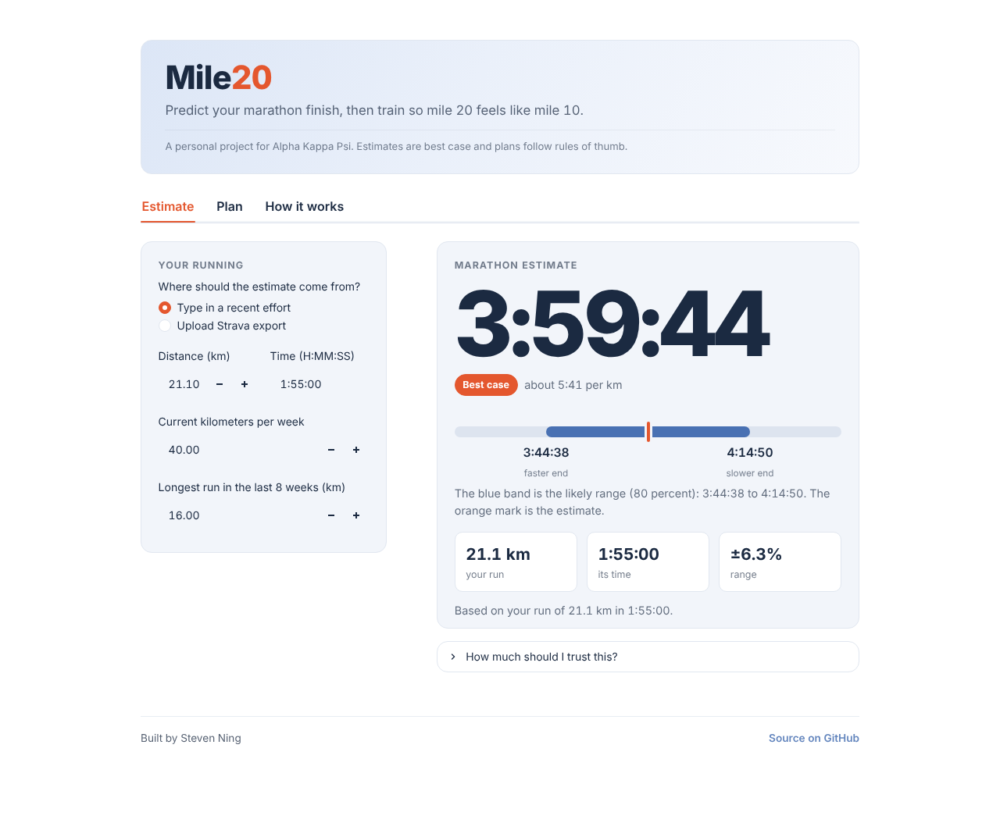
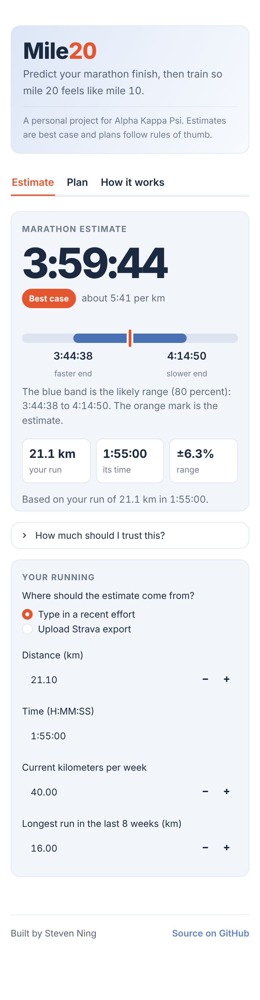
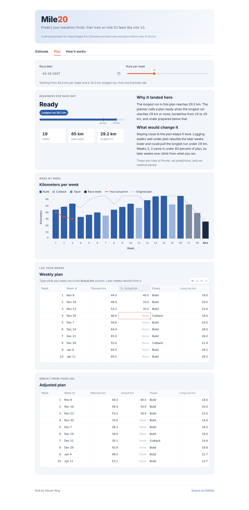
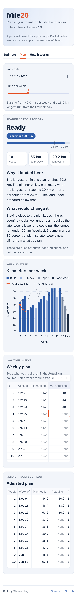
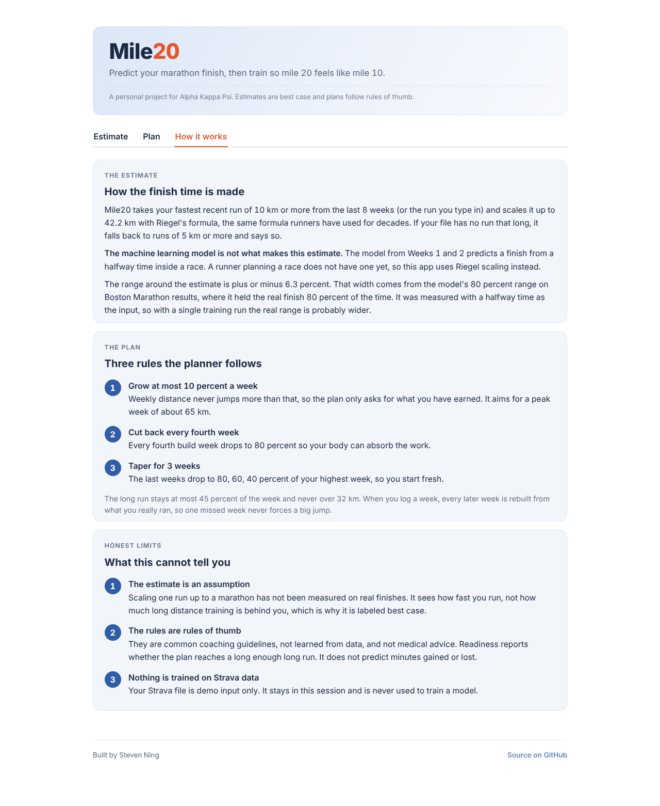
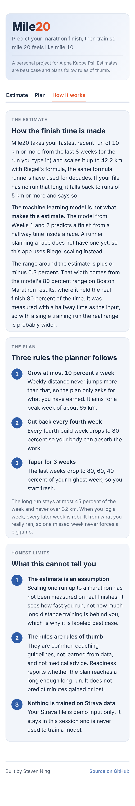
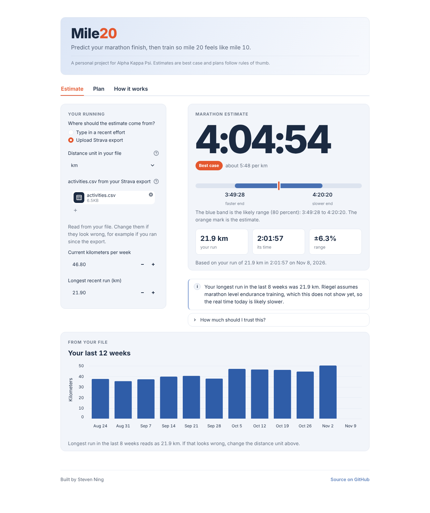
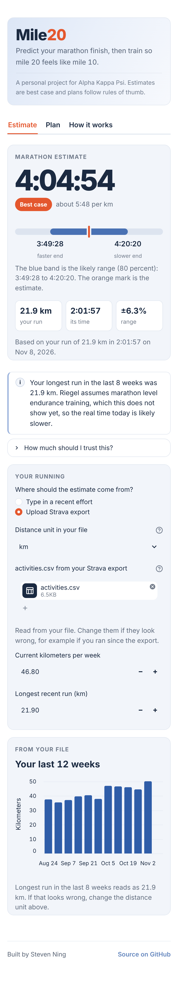

# Mile20

**Predict your marathon finish, then train so mile 20 feels like mile 10.**

Live app: [mile20.streamlit.app](https://mile20.streamlit.app)



A personal project for the Alpha Kappa Psi pledgeship. The goal is to predict a runner's marathon finish time from real race data, beat a classic baseline formula with a machine learning model, and build a training plan that adjusts to how each week actually goes.

## Week 4: the finished app

### Run the app

```
pip install -r requirements.txt
streamlit run app.py
```

The app opens on the Estimate tab with a typed in effort, so it shows a result right away. It has three tabs:

1. **Estimate**: your best case marathon time as a large number, with the 80 percent range drawn as a band, plus calm notes when the run is short, the file is old, or your longest run is under 24 km.
2. **Plan**: a weekly plan colored by phase (build, cutback, taper, race week), a readiness rating that explains itself, and an Actual km column. Type what you really ran and the later weeks rebuild.
3. **How it works**: how the estimate is made, the three planner rules, and the honest limits.

### Run the tests

```
pytest
```

This runs 56 tests. Most check the cleaning, the split, the baselines, the models, the Strava loader, the bridge and the planner. The tests in `tests/test_app.py` open the app with Streamlit's test runner and check that it starts without errors, has the three tabs, shows a best case estimate, and handles a changed or badly typed time without crashing.

### What data is used

1. **Boston Marathon 2024 results** from Kaggle ("2024 Boston Marathon weather and splits" by runningwithrock). This trains and scores the Week 1 and Week 2 models. The file lives in `data/raw/` and is not committed. Without it, the app uses the saved range width of about 6.3 percent.
2. **Fake data** from `marathon/synthetic.py`. The tests and every screenshot in `docs/screenshots/` use only this fake data.
3. **Your own Strava export**, if you upload one in the app. It is demo input only. It stays in your session and is never used to train anything.

### Honest limits

1. **The estimate is Riegel scaling of a recent effort.** The app takes your best recent run (or the one you type in) and scales it up to 42.2 km with Riegel's formula. That is an assumption, not something measured on real finishes, so the app labels it best case.
2. **The machine learning model does not make the estimate.** The Week 1 and Week 2 model predicts a finish from a halfway time inside a race. The app only borrows the width of that model's 80 percent range on Boston, and that range was measured with a stronger input than one training run, so the real range is probably wider.
3. **The plan follows coaching rules of thumb that are not learned from data.** At most 10 percent more distance per week, a cutback week every fourth week at 80 percent, and a 3 week taper. They are not medical advice.
4. **Strava data is never used to train anything.** Strava's terms do not allow it, and the app never does it.

### Screenshots

<table>
<tr><th>Desktop</th><th>Phone</th></tr>
<tr><td></td><td></td></tr>
<tr><td></td><td></td></tr>
<tr><td></td><td></td></tr>
<tr><td></td><td></td></tr>
</table>

## Where things stand

Week 1 is done when this works on real data:

1. Load and clean the Boston Marathon 2024 results.
2. Split the data into train and test sets with a fixed seed.
3. Score two baselines on the test set: classic Riegel, and a calibrated version.

Week 2 adds machine learning models (ridge regression and gradient boosted trees) that have to beat both baselines on the same test rows.

Week 3 adds the Strava bridge, the planner and the first version of the app. Week 4 polishes the app and finishes the write up.

## Setup

```
python3 -m venv .venv
source .venv/bin/activate
pip install -r requirements.txt
```

On Windows, activate with `.venv\Scripts\activate` instead.

## Get the data

1. Make a free Kaggle account.
2. Search Kaggle for "2024 Boston Marathon weather and splits" by runningwithrock.
3. Download it and put the results CSV in `data/raw/`.
4. Check the license on the dataset page and cite it in your report.

The cleaner needs age, gender, first half time, and finish time. Column names are matched loosely. If the file uses different names, the error message lists the columns it found, and you can add them to `ALIASES` in `marathon/data.py`.

## Week 1: the baselines

```
python scripts/run_week1.py data/raw/YOUR_FILE.csv
```

This prints how many rows were dropped and why, the baseline errors in minutes, and saves a chart and a metrics file in `outputs/`.

To check that the code runs before you have the data:

```
python scripts/run_week1.py synthetic
```

That uses fake data and stamps the chart "SYNTHETIC DATA, NOT REAL RESULTS". Never show those numbers.

## Week 2: train the models

```
python scripts/run_week2.py data/raw/YOUR_FILE.csv
```

This picks model settings with cross validation on the train rows only, then scores everything once on the test rows. It prints the comparison table, how much the best model gains over the calibrated baseline (with a 95 percent range from resampling), how often an 80 percent prediction range holds the real finish, and saves a chart and metrics file in `outputs/`. To check the code without data:

```
python scripts/run_week2.py synthetic
```

## Week 3: Strava bridge and planner

Put your Strava export file in `data/strava/activities.csv`. That folder is ignored by git, and the file is demo input only. It is never used to train a model.

```
python scripts/run_week3.py data/raw/Athletes.csv --strava data/strava/activities.csv --race-date 2027-03-14
```

To log weeks you really ran as week:km pairs and watch the plan rebuild, or to test the bridge on one past marathon, add these options:

```
--missed 3:20,4:25
--check-race 2026-06-07 3:58:00
```

This also revisits the 50 runners the Week 1 cleaner dropped.

The bridge turns one recent run into a marathon estimate with Riegel's formula. That is an assumption, not a measured result. The plan follows common coaching rules of thumb listed at the top of `marathon/planner.py`.

## What is in here

1. `app.py`: the Mile20 Streamlit app (Estimate, Plan and How it works tabs)
2. `marathon/data.py`: loads and cleans results, reports every dropped row, makes the train and test split
3. `marathon/baseline.py`: Riegel baseline, calibrated baseline, and error metrics in minutes
4. `marathon/synthetic.py`: fake data for testing the code and for screenshots only
5. `marathon/model.py`: features, ridge and boosted tree models, prediction ranges, bootstrap comparison
6. `marathon/strava.py`: reads a Strava export (demo input only) and summarizes weekly running
7. `marathon/bridge.py`: turns a recent run into a marathon estimate with a range
8. `marathon/planner.py`: builds the weekly plan and rebuilds it when weeks are missed
9. `marathon/outliers.py`: looks closely at the runners the cleaner dropped
10. `scripts/run_week1.py`, `scripts/run_week2.py`, `scripts/run_week3.py`: run each week's pipeline from the terminal
11. `tests/`: tests for the cleaning, the split, the baselines, the models, the Week 3 code and the app
12. `assets/mile20_icon.png`: the app's page icon
13. `docs/screenshots/`: screenshots made with fake data only
14. `NOTES.md`: decision log, written in your own words

## Known limits

1. The first half split is only known partway through a race, so the Week 2 model predicts the finish from a split, not from training history. That is why the app does not use it to make the estimate.
2. Riegel was designed for different race distances, not for the two halves of one race, so it is a rough yardstick. That is why a calibrated baseline is included too.
3. No large public dataset links training logs to finish times. This is a stated limitation of the project. The bridge from a run to a marathon estimate is therefore an assumption, tested on at most one of your own races.
4. The model is trained only on public data. Strava data is not used for training, because Strava's terms prohibit it.
